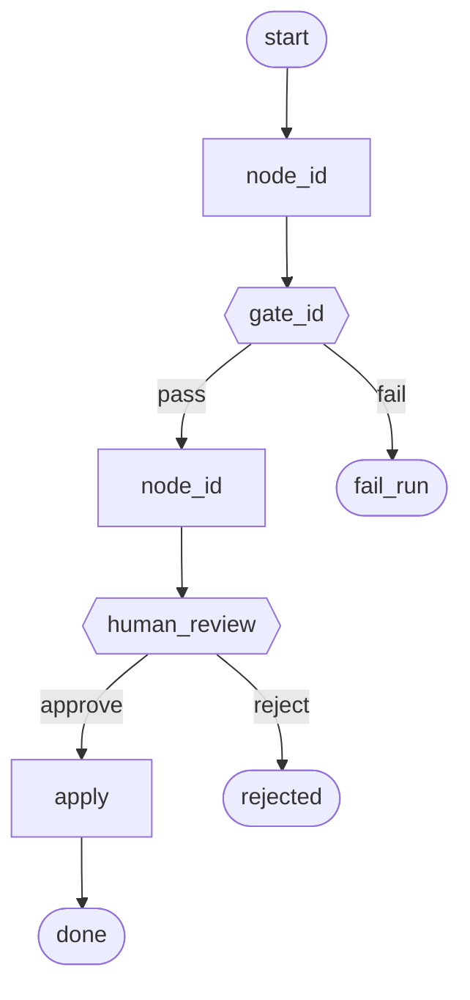

# Harness: <NAME>

**Status:** Draft | Active | Superseded
**Version:** 0.1.0
**Last updated:** YYYY-MM-DD
**Operator story:** <one sentence: press X → wait → approve Y>

> Control flow is owned by this harness. Models run only inside nodes marked `agent`.

## 1. Outcome

### 1.1 Observable result

<what the operator has when a run succeeds>

### 1.2 Golden reference

- **Good:** <path/URL/fixture>
- **Known-bad (must not pass):** <path/URL/fixture + why>

### 1.3 Non-goals

- …
- …
- …

### 1.4 Human liability gate

<what only a human may authorize — e.g. production publish>

## 2. World

| Surface | Access              | Notes |
| ------- | ------------------- | ----- |
| …       | read / write / none | …     |

**Unit of context:** <site | brand | page | repo | …>
**Durable state store:** <db | files | …>
**Forbidden side effects:** <list>

## 3. Control flow

### 3.1 Diagram

### 3.2 Node table

| id | kind                                 | in | out | idempotency | retry | timeout | on_fail | model |
| -- | ------------------------------------ | -- | --- | ----------- | ----- | ------- | ------- | ----- |
| …  | code/agent/gate/human/fan_out/fan_in | …  | …   | …           | …     | …       | …       | …     |

### 3.3 Edges and parallelism

- Sequential: …
- Fan-out: …
- Cycles (evaluator-optimizer only if justified): …

## 4. Artifacts

| name | producer | consumer | schema / path |
| ---- | -------- | -------- | ------------- |
| …    | …        | …        | …             |

## 5. Gates

Each gate is **absolute**. Prefer pure code.

### GATE-<id>

- **After node:** …
- **Pass when:** …
- **Fail when:** …
- **Fail-closed if:** context missing → …
- **Tests:** fixture good / fixture bad

## 6. Human surface

- **When:** after …
- **Shows:** …
- **Actions:** accept | reject | (optional: request re-run)
- **Must not:** force mid-graph orchestration

## 7. Idempotency and resume

| Action                         | Behavior                            |
| ------------------------------ | ----------------------------------- |
| Start while run active         | return existing run id              |
| Start after terminal fail      | new run (or explicit resume policy) |
| Crash mid-node                 | …                                   |
| Re-apply same artifact         | no-op                               |
| Stale "running" with no worker | park/fail; allow clean re-start     |

## 8. Bounds

- Max wall clock per run: …
- Max agent turns per generative node: …
- Max parallel workers: …
- Global stop conditions: …

## 9. Observability

Per node log at least: `run_id`, `node_id`, `status`, `duration_ms`, `artifact_refs`, `error`.
Operator must answer "which node failed?" from logs alone.

## 10. Eval plan

| Check                        | How                 |
| ---------------------------- | ------------------- |
| Gate unit tests              | good + bad fixtures |
| One-press happy path         | …                   |
| Idempotent double-start      | …                   |
| Known-bad cannot reach human | …                   |

## 11. v1 cut line

**In v1:** …
**Deferred:** …

## 12. Changelog / deviations

- YYYY-MM-DD: …
