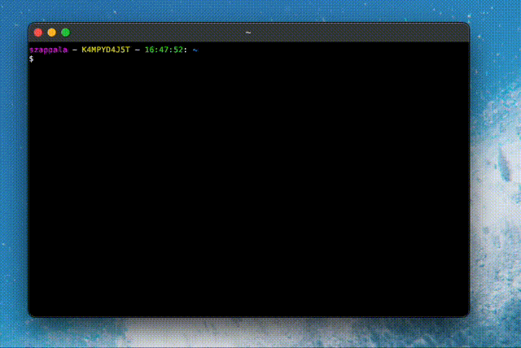

# Gattino 🐱

A [kitty terminal](https://sw.kovidgoyal.net/kitty/) extension that turns plain language into commands using Ollama.



## Requirements

- [kitty terminal](https://sw.kovidgoyal.net/kitty/)
- [ollama](https://ollama.ai/)

## Installation

1. Clone the repository to `~/.config/kitty/gattino`

```bash
git clone https://github.com/szappala/gattino.git ~/.config/kitty/gattino
```

1. Add the following line to `~/.config/kitty/kitty.conf` (note, replace `cmd` with `ctrl` if you are not on a mac)

```bash
map cmd+shift+g kitten gattino/gattino.py
```

## Usage

Press `cmd+shift+g` (or the command that you have mapped to gattino) on your kitty terminal to open the gattino prompt.

## Configuration

The configuration is located in `~/.config/kitty/gattino/gattino.config.json` and the following options are available:

- `model`: The ollama model to use for command translation (default: "codellama")
- `ollama_path`: Path to the ollama executable (default: "/usr/local/bin/ollama")

## Contributing

Contributions are welcome! See [CONTRIBUTING.md](CONTRIBUTING.md) for details on how to get started.
